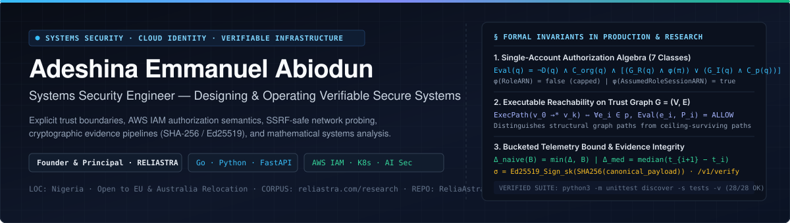
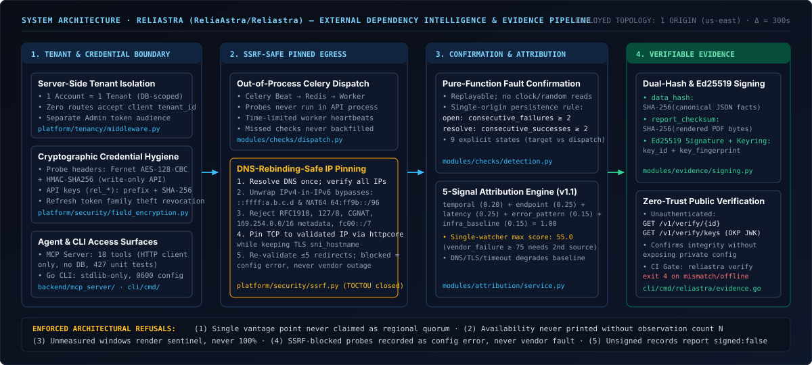
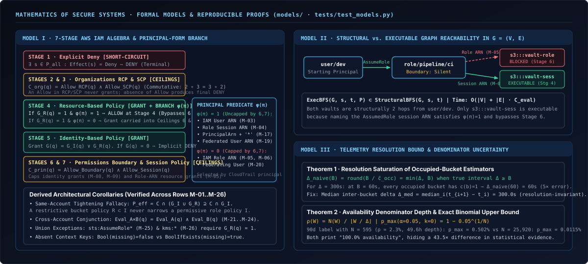

<div align="center">
  
</div>

<p align="center">
  <a href="https://reliastra.com"><strong>reliastra.com</strong></a> ·
  <a href="https://reliastra.com/research"><strong>Research Corpus</strong></a> ·
  <a href="https://reliastra.com/security"><strong>Security Model</strong></a> ·
  <a href="https://github.com/ReliaAstra/Reliastra"><strong>ReliaAstra/Reliastra</strong></a> ·
  <a href="https://www.linkedin.com/in/emmanueladeshina01"><strong>LinkedIn</strong></a> ·
  <a href="https://hashnode.com/@emmanueladeshina01"><strong>Hashnode</strong></a> ·
  <a href="mailto:E.adeshina@proton.me"><strong>E.adeshina@proton.me</strong></a>
</p>

---

## 1. Professional Identity

I am a **systems security engineer** who designs, implements, and operates secure software systems.

Security is not an audit pass added after a backend is written; it is the primary architectural constraint that determines how I define trust boundaries, represent principals and permissions, isolate tenants, handle untrusted network egress, and produce verifiable runtime evidence. My work sits at the intersection of:

- **Systems Security Engineering:** Designing services where security invariants—tenant isolation, credential confinement, SSRF-safe network probing, and tamper-evident audit records—are enforced by construction rather than operator convention.
- **Cloud & Infrastructure Security:** Formal modeling of AWS IAM authorization semantics across all seven policy evaluation classes, privilege-escalation graph reachability, Kubernetes workload isolation, and host/control-plane hardening.
- **Platform & Backend Engineering:** Building deterministic distributed services, APIs, out-of-process job pipelines, and static CLI tooling in **Go** and **Python** (`FastAPI`, `PostgreSQL`, `Redis`, `Celery`).
- **AI Systems Security & Infrastructure:** Analyzing and enforcing trust boundaries around hosted model APIs, egress paths, and agent tool surfaces—including building a production 18-tool **Model Context Protocol (MCP)** server with strict capability scoping and zero direct database access.
- **Security Research & Mathematical Engineering:** Investigating how real security mechanisms behave from primary specifications and captured telemetry, applying boolean algebra, directed graph theory, probability, and estimation theory to build testable engineering models.

I am based in Nigeria and open to systems security, cloud security, and platform engineering roles—including international relocation to the **European Union** and **Australia**.

---

## 2. Principal Engineering Experience

### Founder & Principal Engineer — [RELIASTRA](https://reliastra.com)

*Secure infrastructure, platform engineering, and external dependency intelligence.*  
**Live Platform:** [reliastra.com](https://reliastra.com) · **Documentation:** [reliastra.com/docs](https://reliastra.com/docs) · **Security Model:** [reliastra.com/docs/security](https://reliastra.com/docs/security) · **Methodology:** [reliastra.com/docs/methodology](https://reliastra.com/docs/methodology) · **Research:** [reliastra.com/research](https://reliastra.com/research) · **Monorepo:** [`ReliaAstra/Reliastra`](https://github.com/ReliaAstra/Reliastra) · **CI Action:** [`ReliaAstra/reliastra-action`](https://github.com/ReliaAstra/reliastra-action)

Modern applications depend on external third-party APIs (payments, identity, cloud control planes, hosted AI models) that they do not operate. When an incident occurs, internal application monitoring proves only that the caller failed, while vendor status pages often lag or aggregate away route-level failures. **RELIASTRA** is an independent observation, deterministic fault-confirmation, multi-signal attribution, and cryptographically verifiable evidence platform that I founded, architected, and maintain as principal engineer.

<div align="center">
  
</div>

#### What I Personally Architect, Implement, Secure, and Operate

| Subsystem | Verified Implementation & Security Invariants | Primary Source / Artifact |
|---|---|---|
| **SSRF-Safe, DNS-Rebinding-Safe Network Probing** | Before any probe leaves the worker, `resolve_pinned_target` resolves DNS once, unwraps IPv4-mapped (`::ffff:a.b.c.d`) and NAT64 (`64:ff9b::/96`) IPv6 bypass addresses, and rejects RFC 1918, loopback (`127.0.0.0/8`, `::1/128`), link-local / cloud metadata (`169.254.0.0/16`, `fe80::/10`), CGNAT (`100.64.0.0/10`), and ULA (`fc00::/7`). Closes the DNS-rebinding TOCTOU window via `pinned_transport_for`, which pins the `httpcore` TCP socket directly to the validated IP while preserving the original `Host` header and TLS `sni_hostname` certificate check. Re-validates up to 5 redirect hops (15s deadline). Blocked targets are recorded as `blocked_by_security_policy` configuration errors—never as vendor outages. | [`backend/app/platform/security/ssrf.py`](https://github.com/ReliaAstra/Reliastra/blob/main/backend/app/platform/security/ssrf.py) · [`test_ssrf_pinning.py`](https://github.com/ReliaAstra/Reliastra/blob/main/backend/tests/unit/test_ssrf_pinning.py) · [Security Docs](https://reliastra.com/security) |
| **Server-Side Tenant Isolation & Credential Confinement** | One account maps to one tenant server-side; **zero API routes or MCP tools accept a client-supplied `tenant_id` or `organization_id`**. Secret dependency request headers are encrypted at rest with **Fernet (`AES-128-CBC` + `HMAC-SHA256`)** under a configuration-held key and are write-only over the API (reads return `has_headers: bool` only). Service API keys (`rel_...`) store only a display prefix and a `SHA-256` hash with explicit scope sets. Passwords use `bcrypt`. Session refresh tokens rotate on every use; presenting a revoked refresh token triggers **token-family revocation** to terminate replay. The admin control plane uses a separate token audience and security domain. | [`backend/app/platform/tenancy/middleware.py`](https://github.com/ReliaAstra/Reliastra/blob/main/backend/app/platform/tenancy/middleware.py) · [`field_encryption.py`](https://github.com/ReliaAstra/Reliastra/blob/main/backend/app/platform/security/field_encryption.py) · [`tokens.py`](https://github.com/ReliaAstra/Reliastra/blob/main/backend/app/platform/security/tokens.py) · [`test_auth_token_family.py`](https://github.com/ReliaAstra/Reliastra/blob/main/backend/tests/unit/test_auth_token_family.py) |
| **Out-of-Process Scheduling & Pure-Function Fault Confirmation** | Probes are scheduled by **Celery Beat** and executed by **Celery Workers** over **Redis**, completely decoupled from the **FastAPI** (`/v1/*`, 186 OpenAPI paths) request process. Probe workers never read HTTP response bodies (storing only timestamp, status, latency, and verdict). Missed probes are never backfilled with synthetic data. Incident confirmation in `detection.py` is a pure, clock-free function of stored `CheckOutcome` rows: under the deployed `single` topology (`us-east`, 300s default interval), `single.consecutive_failures` (threshold `2`) opens an incident and `single.consecutive_successes` (threshold `2`) resolves it. | [`backend/app/modules/checks/detection.py`](https://github.com/ReliaAstra/Reliastra/blob/main/backend/app/modules/checks/detection.py) · [`dispatch.py`](https://github.com/ReliaAstra/Reliastra/blob/main/backend/app/modules/checks/dispatch.py) · [`test_check_detection.py`](https://github.com/ReliaAstra/Reliastra/blob/main/backend/tests/unit/test_check_detection.py) · [Methodology Docs](https://reliastra.com/docs/methodology) |
| **Deterministic 5-Signal Attribution Engine (`v1.1`)** | Computes a reproducible score $S \in [0, 100]$ across five normalized signals with fixed weights summing to `1.00`: `temporal` ($0.20$), `endpoint_overlap` ($0.25$), `latency_correlation` ($0.25$), `error_pattern` ($0.15$), and `infrastructure_baseline` ($0.15$). Separates corroboration signals (`temporal`, `endpoint_overlap`) so a single uncorroborated watcher is bounded above by $55.0$ (preventing a false `vendor_failure` $\ge 75$ verdict without corroboration). Transport failures that receive no HTTP response (`dns_error`, `tls_error`, `connection_error`, `timeout`) degrade `infrastructure_baseline` rather than attributing fault to the vendor. | [`backend/app/modules/attribution/service.py`](https://github.com/ReliaAstra/Reliastra/blob/main/backend/app/modules/attribution/service.py) · [`test_attribution_engine.py`](https://github.com/ReliaAstra/Reliastra/blob/main/backend/tests/unit/test_attribution_engine.py) |
| **Cryptographic Evidence & Unauthenticated Verification** | Resolved incidents compile into immutable evidence artifacts carrying: (1) `data_hash` (`SHA-256` over canonical JSON payload facts), (2) `report_checksum` (`SHA-256` over rendered PDF bytes), and (3) an **Ed25519 signature** over the canonical payload bytes with `key_id`, `key_fingerprint` (to make key-substitution attacks detectable across rotations), and `EVIDENCE_SIGNING_KEYRING` for historical verification. Third parties verify artifacts without an account via `GET /v1/verify/{id}` and `GET /v1/verify/keys`. | [`backend/app/modules/evidence/signing.py`](https://github.com/ReliaAstra/Reliastra/blob/main/backend/app/modules/evidence/signing.py) · [`canonical.py`](https://github.com/ReliaAstra/Reliastra/blob/main/backend/app/modules/evidence/canonical.py) · [Evidence Docs](https://reliastra.com/docs/evidence) · [Verification Docs](https://reliastra.com/docs/verification) |
| **Static Go CLI & GitHub Actions Pipeline Gate** | Zero-dependency **Go 1.23 CLI** (`cli/cmd/reliastra`) compiled across Linux, macOS, and Windows (`amd64`/`arm64`) with SHA-256 release verification and GitHub provenance attestations. Writes config with `0600` permissions inside a `0700` directory, refuses plaintext password flags, revokes tokens both server-side and locally on `logout`, and enforces deterministic CI exit codes (`0` ok, `1` usage, `2` api, `3` auth, `4` unverified evidence claim, `5` scope denied, `6` network unreachable). Companion GitHub Action (`ReliaAstra/reliastra-action`) gates CI workflows on live dependency health and evidence links. | [`cli/cmd/reliastra/`](https://github.com/ReliaAstra/Reliastra/tree/main/cli/cmd/reliastra) · [`cli/README.md`](https://github.com/ReliaAstra/Reliastra/blob/main/cli/README.md) · [`ReliaAstra/reliastra-action`](https://github.com/ReliaAstra/reliastra-action) · [CLI Docs](https://reliastra.com/docs/cli) |
| **Model Context Protocol (MCP) Server for AI Agents** | Production **18-tool MCP server** (`stdio` and Streamable HTTP at `https://api.reliastra.com/mcp`, protocol `2025-11-25`) built as a strict HTTP client of the canonical API—zero database credentials, zero ORM imports, and zero duplicated business logic. Enforces deny-by-default scope inference, substring and URL-query credential redaction (`?sig=`, `report_token`), host allowlisting (`MCP_HTTP_ALLOWED_HOSTS`), and audit logging on the 2 write tools (`register_dependency`, `trigger_check`). Guarded by **427 unit tests**. | [`backend/mcp_server/`](https://github.com/ReliaAstra/Reliastra/tree/main/backend/mcp_server) · [`backend/tests/unit/mcp/`](https://github.com/ReliaAstra/Reliastra/tree/main/backend/tests/unit/mcp) · [MCP Docs](https://reliastra.com/docs/mcp) |

#### Honest Scope: Shipped in Production vs. In Development

- **Shipped & Operating Today:** Single observation origin (`us-east`) on a 300-second default cadence; SSRF-pinned HTTP probing; deterministic persistence confirmation (`2` consecutive failures / `2` consecutive successes); 5-signal attribution engine (`v1.1`); SHA-256 + Ed25519 evidence generation and unauthenticated public verification; public dependency observatory ([reliastra.com/observatory](https://reliastra.com/observatory)); REST API; static Go CLI; webhooks; GitHub Action; and the 18-tool MCP server. Every public record states that measurements originate from 1 observation point today and makes no regional quorum claim.
- **In Active Development (Not Claimed as Shipped):** Additional independently operated regional observation points to activate the implemented `multi.observation_quorum` rule in production; caller-side telemetry ingestion (SDK / OpenTelemetry) to pair external route observations with caller-side observations; and cross-application dependency correlation.

---

## 3. Systems Security as the Organizing Principle

I approach engineering across the full security lifecycle:

$$\text{Threat Model} \longrightarrow \text{Architecture} \longrightarrow \text{Implementation} \longrightarrow \text{Verification} \longrightarrow \text{Deployment} \longrightarrow \text{Observation} \longrightarrow \text{Revision}$$

Every system in this portfolio is organized around answering concrete security design questions in code:

| Security Engineering Question | Architectural Enforcement in My Work | Verified Evidence |
|---|---|---|
| **Which principals can perform which actions, under what conditions?** | Modeled AWS IAM's 7-stage evaluation algebra (`Short-Circuit`, `Cap`, `Grant`) and separated human session tokens from scoped service API keys (`rel_...` closed to account/identity mutation surfaces; admin plane isolated by token audience). | [`models/iam_authorization_model.py`](./models/iam_authorization_model.py) · [`ReliaAstra/Reliastra/backend/app/api/deps.py`](https://github.com/ReliaAstra/Reliastra/blob/main/backend/app/api/deps.py) |
| **Where are the trust boundaries, and which properties are enforced by architecture rather than convention?** | Tenant scoping is bound to the authenticated session/key in server middleware; no endpoint or MCP tool accepts a tenant parameter in its schema, making cross-tenant queries unrepresentable by construction. | [`ReliaAstra/Reliastra/backend/app/platform/tenancy/middleware.py`](https://github.com/ReliaAstra/Reliastra/blob/main/backend/app/platform/tenancy/middleware.py) · [`backend/mcp_server/README.md`](https://github.com/ReliaAstra/Reliastra/blob/main/backend/mcp_server/README.md) |
| **Can untrusted input influence network destinations or exploit DNS rebinding?** | URL targets are resolved once, normalized (unwrapping `::ffff:0:0/96` and NAT64 `64:ff9b::/96`), checked against 11 blocked private/link-local/metadata networks, and TCP-pinned via `httpcore` across every redirect hop. | [`ReliaAstra/Reliastra/backend/app/platform/security/ssrf.py`](https://github.com/ReliaAstra/Reliastra/blob/main/backend/app/platform/security/ssrf.py) · [`test_ssrf_pinning.py`](https://github.com/ReliaAstra/Reliastra/blob/main/backend/tests/unit/test_ssrf_pinning.py) |
| **How are credentials handled, isolated, and protected at rest and in transit?** | Probe headers use Fernet (`AES-128-CBC` + `HMAC-SHA256`) write-only encryption; API keys use prefix + `SHA-256`; refresh tokens rotate with family revocation on replay; CLI credentials enforce `0600` file modes and never accept passwords via CLI flags. | [`ReliaAstra/Reliastra/backend/app/platform/security/`](https://github.com/ReliaAstra/Reliastra/tree/main/backend/app/platform/security) · [`cli/cmd/reliastra/config.go`](https://github.com/ReliaAstra/Reliastra/blob/main/cli/cmd/reliastra/config.go) |
| **What happens when an external dependency or observer infrastructure degrades?** | Probe execution runs out-of-process in Celery; worker/scheduler liveness is tracked via time-limited heartbeats; transport errors without HTTP responses (`dns_error`, `tls_error`, `timeout`) degrade observer baseline rather than blaming the vendor. | [`ReliaAstra/Reliastra/backend/app/modules/checks/scheduler_health.py`](https://github.com/ReliaAstra/Reliastra/blob/main/backend/app/modules/checks/scheduler_health.py) · [`attribution/service.py`](https://github.com/ReliaAstra/Reliastra/blob/main/backend/app/modules/attribution/service.py) |
| **Can an observed security or reliability event be independently reconstructed and verified?** | Incident confirmation is a pure, clock-free function replayable from stored rows; evidence records bind canonical payload `SHA-256`, PDF `SHA-256`, and `Ed25519` signatures with a public JWK keyring and unauthenticated verification endpoint. | [`ReliaAstra/Reliastra/backend/app/modules/evidence/signing.py`](https://github.com/ReliaAstra/Reliastra/blob/main/backend/app/modules/evidence/signing.py) · [`EmmanuelAdesina/chimera/chimera/models/evidence.py`](https://github.com/EmmanuelAdesina/chimera/blob/main/chimera/models/evidence.py) |
| **Which controls can be verified before deployment, and which require runtime evidence?** | Analyzed the formal pre-deployment verification gap across AWS IAM's 7 policy classes (`SimulatePrincipalPolicy` vs. `Access Analyzer` SMT checks vs. runtime `CloudTrail` principal attribution) and built static-to-dynamic verification loops in CHIMERA. | [AWS IAM Evaluation Paper](https://reliastra.com/research/cloud-security/aws-iam-policy-evaluation-order) · [`EmmanuelAdesina/chimera`](https://github.com/EmmanuelAdesina/chimera) |

---

## 4. Published Security & Systems Research

My research is published in the **[RELIASTRA Research Corpus](https://reliastra.com/research)** and versioned alongside its supporting artifacts, bibliographies, and reproduction scripts in [`ReliaAstra/Reliastra/tree/main/research`](https://github.com/ReliaAstra/Reliastra/tree/main/research). Every entry explicitly distinguishes **primary-source architectural analysis** from **independently measured API telemetry** and **reproducible audits**.

### 4.1 Flagship Cloud Security Paper

#### [AWS IAM policy evaluation logic: identity vs resource](https://reliastra.com/research/cloud-security/aws-iam-policy-evaluation-order)

- **Author & Date:** Adeshina Emmanuel · Published & Verified `13 September 2026`
- **Technical Domain:** Cloud Security · AWS IAM Authorization Semantics · Formal Policy Verification · Zero Trust (`NIST SP 800-207`)
- **Evidence Basis:** **Literature & Primary-Source Architecture Analysis** (Close reading of 15 AWS primary documentation specifications, 3 peer-reviewed formal-methods papers on AWS's `Zelkova` SMT engine and stratified predicate abstraction [`DOI:10.23919/FMCAD.2018.8602994`, `DOI:10.1007/978-3-030-53288-8_9`, `DOI:10.1007/978-3-031-13185-1_1`], and API/CLI verification references. *Explicit disclosure: no live AWS control-plane measurements or simulator captures were performed for this paper; all 26 decision-matrix rows are derived analytically from the documented specification.*)
- **Research Question:** *What is the exact decision procedure AWS executes when identity-based and resource-based policies disagree, and which parts of that procedure can an engineer verify before deployment rather than after a denial?*
- **Main Findings:**
  1. **Seven Policy Classes, Three Algebraic Roles:** AWS evaluates seven classes in a fixed order—(1) Explicit Deny `[Short-Circuit]`, (2) Organizations RCPs `[Cap]`, (3) Organizations SCPs `[Cap]`, (4) Resource-based policies `[Grant]`, (5) Identity-based policies `[Grant]`, (6) Permissions boundaries `[Cap]`, and (7) Session policies `[Cap]`. Four of the seven classes are ceilings that can only subtract permission; writing an `Allow` in an SCP, RCP, permissions boundary, or session policy is algebraically inert.
  2. **The Same-Account Tightening Fallacy:** Inside a single account, identity-based and resource-based permissions combine by **union** ($I \cup R$). A restrictive S3 bucket policy cannot narrow a broad IAM role policy inside the same account; reduction requires one of the four ceilings or an explicit `Deny`.
  3. **The Principal-Form Ceiling Branch:** Whether a same-account resource-based `Allow` survives an implicit deny in a permissions boundary or session policy is a function of the **principal form named in the resource policy**. Naming an `IAM User ARN`, an `AssumedRole Session ARN` (`arn:aws:sts::...:assumed-role/R/s`), a `Federated User ARN`, or a wildcard `Principal` with `aws:PrincipalArn` bypasses silent boundaries/session policies at Stage 4 (`M-03`, `M-04`, `M-17`, `M-19`). Naming an `IAM Role ARN` (`arn:aws:iam::...:role/R`) or the `Federating IAM User ARN` subjects the grant to Stage 6 and Stage 7 ceilings (`M-05`, `M-06`, `M-20`).
  4. **Commutativity of Organizational Ceilings:** Evaluating RCPs (Stage 2) before SCPs (Stage 3) cannot alter any authorization verdict because explicit denies short-circuit at Stage 1 and both ceilings only intersect grants.
  5. **Cross-Account Conjunction:** Across accounts, the same-account union is replaced by a conjunction of two independent evaluations $\operatorname{Eval}_ {\text{trusted}}(q) \wedge \operatorname{Eval}_ {\text{trusting}}(q)$, each subject to its own organizational ceilings (`M-21..M-24`).
  6. **The Pre-Deployment Verification Gap:** No pre-deployment tool evaluates all seven classes. The IAM Policy Simulator (`SimulatePrincipalPolicy`) does not evaluate RCPs, does not accept session policies, and does not support resource-based policy simulation for IAM roles; IAM Access Analyzer custom policy checks (`check-no-new-access`) compare policy documents via SMT without a request context (no principal, no ceilings).
  7. **Denial Attribution Requires CloudTrail `userIdentity.type`:** `sts:DecodeAuthorizationMessage` distinguishes an explicit deny from an absent allow without naming the deciding policy class; the CloudTrail principal type (`IAMUser` vs. `AssumedRole` vs. `FederatedUser`) is the discriminator that selects which branch of Stage 4 applied.
- **Documented Limitations & Unsettled Questions:** Reports two places where AWS primary documentation leaves behavior ambiguous rather than smoothing them over: (a) whether a permissions boundary caps a resource-based grant to an IAM role ARN when the identity policy is silent, and (b) the sequential wording of the three bullets in Stage 7 (session policies) for assumed-role sessions. Out of scope: VPC endpoint policies, ABAC tag patterns, and per-service catalogues beyond S3, KMS, and STS.
- **Supporting Artifacts:**
  - **Published Paper:** [`reliastra.com/research/cloud-security/aws-iam-policy-evaluation-order`](https://reliastra.com/research/cloud-security/aws-iam-policy-evaluation-order)
  - **Monorepo Artifact & Annotated Bibliography:** [`ReliaAstra/Reliastra/tree/main/research/aws-iam-evaluation-order`](https://github.com/ReliaAstra/Reliastra/tree/main/research/aws-iam-evaluation-order)
  - **Executable Algebra & 26-Row Decision Matrix Test Suite (in this repo):** [`models/iam_authorization_model.py`](./models/iam_authorization_model.py) · [`tests/test_models.py`](./tests/test_models.py)

---

### 4.2 Selected Research Corpus: AI Trust Boundaries & Measurement Integrity

| Publication & Verified Date | Domain & Evidence Basis | Research Question & Core Technical Contribution | Practical Implications & Limitations | Links & Artifacts |
|---|---|---|---|---|
| **[Why an interval estimated from bucketed telemetry converges on the bucket length](https://reliastra.com/research/measurement-integrity/probe-interval-from-bucketed-telemetry)**<br/>`11 Sep 2026` · *RELIASTRA Research* | **Measurement Integrity & Distributed Telemetry**<br/>*Basis:* Analytical bound + independently measured production API series (`12` observations, `us-east`) | **Question:** *Why does an observation interval estimated from bucketed telemetry converge on the bucket length?*<br/>**Finding:** Proves that the occupied-bucket density estimator $\hat{\Delta}_ {\text{naive}}(B) = \mathrm{round}(B / \bar{c}_ {\text{occ}})$ equals $\min(\Delta, B)$ for any regular schedule $\Delta \ge B$ because empty buckets are omitted by the timeline API and every occupied bucket holds $c(b)=1$ observation. Explains why a single production page simultaneously printed `"about every 60 seconds"` (from a `1m` timeline) and `"≈ every 300 seconds"` (from a `5m` timeline) for the same $\Delta=300\text{ s}$ schedule. | **Implication:** Replaced occupied-bucket density estimation with the resolution-invariant median inter-bucket delta $\hat{\Delta}_ {\text{med}} = \operatorname{median}_ i(t_{i+1}-t_i) = 300\text{ s}$ and added a regression test pinned to the captured payload.<br/>**Limitation:** Exact bound applies to regular schedules; irregular jittered schedules are bounded approximately. | [Paper](https://reliastra.com/research/measurement-integrity/probe-interval-from-bucketed-telemetry) · [Dataset & Audit Script](https://github.com/ReliaAstra/Reliastra/tree/main/research/availability-record-audit) · [`telemetry_integrity_model.py`](./models/telemetry_integrity_model.py) |
| **[How much evidence stands behind a published availability figure?](https://reliastra.com/research/measurement-integrity/availability-record-audit)**<br/>`11 Sep 2026` · *RELIASTRA Research* | **Measurement Integrity & Observability Audit**<br/>*Basis:* Independently measured public API responses (6 verbatim JSON captures, `CC-BY-4.0`) + stdlib `audit.py` | **Question:** *Can a reader of a published availability record determine, from the record itself, how much evidence stands behind each percentage it publishes?*<br/>**Finding:** Auditing RELIASTRA's own public record for OpenAI revealed that the `7d`, `30d`, and `90d` windows returned byte-identical aggregates (`N = 595` observations, `100.0%`, `570.67 ms` mean, `840.33 ms` p95)—meaning the `"90 days"` label stood on `49.6 hours` ($\approx 2.1$ days, `2.3%` density) of evidence rather than `25,920` observations. | **Implication:** Introduces three portable audit checks—**Window Monotonicity**, **History Depth** ($D = N\cdot\Delta$), and **Observation Density** $\rho(W) = N/\lfloor W/\Delta\rfloor$, applicable to any vendor's availability API.<br/>**Limitation:** Audits sample depth and disclosure completeness, not endpoint uptime correctness. | [Paper](https://reliastra.com/research/measurement-integrity/availability-record-audit) · [`audit.py` & Raw JSON](https://github.com/ReliaAstra/Reliastra/tree/main/research/availability-record-audit) · [`test_models.py`](./tests/test_models.py) |
| **[The trust boundary of an AI API dependency](https://reliastra.com/research/cloud-security/ai-api-trust-boundary)**<br/>`11 Sep 2026` · *RELIASTRA Research* | **AI Infrastructure Security & Zero Trust**<br/>*Basis:* Architectural trust-boundary decomposition (`NIST SP 800-207`, `RFC 8446`) + 1 measured vendor endpoint record | **Question:** *What changes about an application's trust boundary when its model is a network call to a third party, and which controls that boundary used to imply no longer exist?*<br/>**Finding:** Decomposes four structural shifts: (1) unstructured retrieval/prompt context crossing into a third-party trust domain, (2) unobservable provider-side model routing, (3) separation between the **status plane** (`status.openai.com`) and the **inference serving plane** (`api.openai.com`), and (4) retry policies acting as financial/quota controls alongside reliability controls. | **Implication:** mTLS and service-mesh identity terminate at the egress edge; enforceable consumer controls are pre-egress redaction, data minimization, bounded retry budgets, and independent serving-plane egress records.<br/>**Limitation:** Reference architectural analysis; does not audit internal controls of any specific model provider. | [Paper](https://reliastra.com/research/cloud-security/ai-api-trust-boundary) · [Cloud & AI Security Collection](https://reliastra.com/research/cloud-security) |
| **[What a status-page payload actually asserts](https://reliastra.com/research/ai-infrastructure/status-page-payload-anatomy)**<br/>`11 Sep 2026` · *RELIASTRA Research* | **AI Infrastructure & Incident Evidence**<br/>*Basis:* Verbatim capture and structural analysis of `status.openai.com/api/v2/summary.json` | **Question:** *What does a hosted status-page payload actually assert, and how much incident evidence does it contain?*<br/>**Finding:** Separates a status payload into taxonomy (`25` named components), current declaration (`indicator: "none"`), and temporal evidence (empty: `page.updated_at` and all `25` component `updated_at` timestamps were identical at `63 days 16 hours` old, matching the newest component's `created_at`). | **Implication:** Polling `summary.json` provides a valuable component inventory and a point-in-time assertion, but zero historical incident evidence and no proof of when health was last verified.<br/>**Limitation:** Single-timestamp capture of one Atlassian Statuspage summary endpoint. | [Paper](https://reliastra.com/research/ai-infrastructure/status-page-payload-anatomy) · [Captured Payload JSON](https://github.com/ReliaAstra/Reliastra/blob/main/research/availability-record-audit/data/openai-statuspage-summary-2026-09-11T1136Z.json) |

> **Complete Corpus:** Browse all 10 published papers, methodology notes, and datasets at **[reliastra.com/research](https://reliastra.com/research)**.

---

## 5. Mathematics of Secure Systems

Mathematical modeling in my work is used to turn ambiguous system specifications into decidable properties, prove failure bounds on estimators, and separate structural graph paths from executable security conditions. Every model below is implemented in **[`models/`](./models)** and verified by automated unit tests in **[`tests/test_models.py`](./tests/test_models.py)** (`28/28` passing; run locally with `python3 -m unittest discover -s tests -v` or `python3 -m models.demo`).

<div align="center">
  
</div>

### 5.1 Policy Evaluation as an Order-Sorted Boolean Algebra

1. **Concrete Engineering Question:** Given a request context $q = (\pi, a, r, \kappa)$—where $\pi$ is the calling principal, $a$ is the action, $r$ is the target resource, and $\kappa$ is the key-value condition context—when does a resource-based `Allow` override an implicit deny in a permissions boundary or session policy, and why does adding a restrictive bucket policy inside the same AWS account fail to narrow an over-permissive role?
2. **Mathematical Model:** Partition the seven AWS policy classes into three algebraic operators over $q$:
   - **Short-Circuit Deny ($D$):** $D(q) = 1 \iff \exists s \in \mathcal{P}_ {\text{all}}(q) \text{ such that } \operatorname{Effect}(s) = \text{Deny} \wedge \operatorname{Matches}(s, q)$.
   - **Organizational Ceilings ($C_{\text{org}}$):** $C_{\text{org}}(q) = C_{\text{RCP}}(q) \wedge C_{\text{SCP}}(q)$, where an attached ceiling evaluates to $1$ iff it contains at least one matching `Allow` (and $C_{\text{SCP}}(q) \equiv 1$ when $\pi$ is a service-linked role).
   - **Principal Ceilings ($C_{\text{prin}}$):** $C_{\text{prin}}(q) = C_{\text{Boundary}}(q) \wedge C_{\text{Session}}(q)$.
   - **Granting Classes ($G_R, G_I$) & Principal-Form Predicate $\phi(\pi_R)$:** Let $G_R(q), G_I(q) \in \{0, 1\}$ denote matching `Allow` statements in the resource-based and identity-based policies. Define the principal-form ceiling-bypass predicate $\phi(\pi_R) \in \{0, 1\}$ over the principal form $\pi_R$ named in the resource-based grant:

$$\phi(\pi_R) = \begin{cases} 1 & \text{if } \pi_R \in \{\texttt{IAMUserARN},\; \texttt{AssumedRoleSessionARN},\; \texttt{WildcardPrincipalWithArnCond},\; \texttt{FederatedUserARN}\} \\ 0 & \text{if } \pi_R \in \{\texttt{IAMRoleARN},\; \texttt{FederatingIAMUserARN}\} \end{cases}$$

   For any non-root principal inside a single account on a standard action, $\neg\operatorname{ReqExplicitRes}(a)$, the authorization verdict is:

$$\operatorname{Eval}_{\text{same}}(q) = \neg D(q) \;\wedge\; C_{\text{org}}(q) \;\wedge\; \Big( \big(G_R(q) \wedge \phi(\pi_R)\big) \;\vee\; \big((G_I(q) \vee G_R(q)) \wedge C_{\text{prin}}(q)\big) \Big)$$

   Across two distinct accounts $A$ (trusted/principal) and $B$ (trusting/resource), the union disappears and the decision is the conjunction:

$$\operatorname{Eval}_{A \to B}(q) = \operatorname{Eval}_A(q) \;\wedge\; \operatorname{Eval}_B(q)$$

3. **Explicit Assumptions:** Assumes standard AWS service semantics where same-account union holds; for exception actions $\operatorname{ReqExplicitRes}(a) \in \{\texttt{sts:AssumeRole*}, \texttt{kms:*}\}$, $G_R(q) = 1$ is a mandatory precondition (`M-25`, `M-26`). Assumes AWS's documented `NotPrincipal + Deny` rule (`M-18`): any resource-based `Deny` with `NotPrincipal` evaluates $D(q) = 1$ whenever $C_{\text{Boundary}}$ is attached to $\pi$.
4. **Worked Example & Reproducible Implementation:**
   - **Case A (`M-05`, Role ARN Capped):** An assumed-role session $\pi = \texttt{arn:aws:sts::111122223333:assumed-role/pipeline/ci}$ requests `s3:GetObject`. The bucket policy grants `Allow` to $\pi_R = \texttt{arn:aws:iam::111122223333:role/pipeline}$, where $\phi(\pi_R) = 0$, and the role has an attached permissions boundary silent on S3, $C_{\text{Boundary}}(q) = 0$. Then $G_R(q) \wedge \phi(\pi_R) = 0$ and $(G_I(q) \vee G_R(q)) \wedge C_{\text{prin}}(q) = 1 \wedge 0 = 0 \implies \operatorname{Eval}_ {\text{same}}(q) = \mathbf{0\ (\text{DENY at Stage 6})}$.
   - **Case B (`M-04`, Session ARN Uncapped):** The identical bucket policy instead names $\pi_R = \texttt{arn:aws:sts::111122223333:assumed-role/pipeline/ci}$, so $\phi(\pi_R) = 1$. Then $G_R(q) \wedge \phi(\pi_R) = 1 \implies \operatorname{Eval}_ {\text{same}}(q) = \mathbf{1\ (\text{ALLOW at Stage 4})}$, completely bypassing the silent permissions boundary and session policy.
   - **Reproduce:** Verified across all 26 contexts (`M-01..M-26`) in [`models/iam_authorization_model.py`](./models/iam_authorization_model.py) and [`tests/test_models.py`](./tests/test_models.py).
5. **Engineering Decision:** (a) Never use a restrictive resource-based policy inside one account to constrain an over-broad identity policy—since $C \cap (G_I \cup G_R) \⊇ C \cap G_I$, only a ceiling ($C_{\text{RCP}}, C_{\text{SCP}}, C_{\text{Boundary}}, C_{\text{Session}}$) or an explicit `Deny` ($D$) reduces effective permission. (b) In resource policies, always audit whether the `Principal` names a role ARN vs. a role session ARN, and read `userIdentity.type` in CloudTrail before investigating a denial.
6. **Computational & Practical Limitations:** Evaluating a concrete request $q$ against a resolved policy set $\mathcal{P}_ {\text{all}}$ takes linear time $\mathcal{O}(\sum_{c=1}^7 |\mathcal{P}_ c|)$ in the number of statements. However, deciding **policy equivalence or subsumption**, $\forall q,\; \operatorname{Eval}_ {\mathcal{P}_ 1}(q) \implies \operatorname{Eval}_ {\mathcal{P}_ 2}(q)$, over string wildcards, regular expressions, and numeric conditions is **PSPACE-complete** (encoded into SMT by AWS Zelkova / Access Analyzer; see Backes et al., *FMCAD 2018*).

---

### 5.2 Authorization Graphs $G=(V,E)$ & Structural vs. Executable Reachability

1. **Concrete Engineering Question:** Given an AWS environment with hundreds of IAM users, roles, compute services, and target resources, how do we enumerate privilege-escalation paths from a starting principal $v_0$ to a high-privilege target $v^\star$ without flooding engineers with false-positive paths that are blocked by permissions boundaries, SCPs, or unfulfilled trust policies?
2. **Mathematical Model:** Define a directed multi-graph $G = (V, E, \lambda)$ where:
   - $V = V_{\text{user}} \cup V_{\text{role}} \cup V_{\text{session}} \cup V_{\text{service}} \cup V_{\text{resource}}$ is the set of identities and resources.
   - Each directed edge $e = (u, v, \alpha, q_e) \in E$ represents a candidate transition action $\alpha \in \{\texttt{sts:AssumeRole}, \texttt{iam:PassRole}, \texttt{iam:AttachRolePolicy}, \texttt{iam:PutRolePolicy}, \texttt{iam:UpdateAssumeRolePolicy}, \texttt{s3:GetObject}, \dots\}$ with request context $q_e$.
   - A **structural path** of length $k$ is any sequence $p = (e_1, e_2, \dots, e_k)$ with $\operatorname{src}(e_1) = v_0$, $\operatorname{dst}(e_k) = v^\star$, and $\operatorname{dst}(e_i) = \operatorname{src}(e_{i+1})$ where each $e_i$ appears in a policy statement's `Action`/`Resource` syntax:

$$\operatorname{Paths}_{\text{struct}}(G, v_0, v^\star) = \big\{ p = (e_1, \dots, e_k) \;\big|\; \forall i,\; e_i \in E \big\}$$

   - An **executable authorization path** requires every transition edge $e_i$ along $p$ to pass the 7-stage evaluation algebra, or cross-account conjunction when $\operatorname{acct}(u_i) \ne \operatorname{acct}(v_i)$:

$$\operatorname{Paths}_{\text{exec}}(G, v_0, v^\star) = \big\{ p \in \operatorname{Paths}_{\text{struct}}(G, v_0, v^\star) \;\big|\; \forall e_i \in p,\; \operatorname{Eval}(q_{e_i}) = 1 \big\} \;\subseteq\; \operatorname{Paths}_{\text{struct}}(G, v_0, v^\star)$$

3. **Explicit Assumptions & Complexity Analysis:**
   - When each hop's effective policy context $q_{e_i}$ depends only on the current vertex $u_i$ and target $v_i$ (standard role chaining where no inline session policy is intersected across hops), shortest executable path discovery via cycle-safe Breadth-First Search (`ExecBFS`) runs in:

$$\text{Time: } \mathcal{O}\big(|V| + |E| \cdot C_{\text{eval}}\big), \qquad \text{Space: } \mathcal{O}(|V|)$$

   where $C_{\text{eval}}$ is the per-edge 7-stage evaluation cost.
   - If callers pass dynamic inline STS session policies that accumulate across hops, the state space expands from $V$ to $V \times 2^{\mathcal{A}}$ (where $\mathcal{A}$ is the set of restricted actions), making general constraint-coupled reachability NP-hard.
4. **Worked Example & Reproducible Implementation:** In [`AuthorizationGraph`](./models/iam_authorization_model.py) (and the Go implementation in [`remediation/cloud-identity-security-engineering/internal/graph/identity_graph.go`](./remediation/cloud-identity-security-engineering/internal/graph/identity_graph.go)), `user/dev` can assume `role/pipeline/ci` (which carries a silent permissions boundary). `StructuralBFS` reports two 2-hop paths to `s3:::prod-vault-role-arn` and `s3:::prod-vault-session-arn`. `ExecBFS` prunes `s3:::prod-vault-role-arn` at Stage 6 (`M-05`) and retains only `s3:::prod-vault-session-arn` (`M-04`).
5. **Engineering Decision:** Keeps graph traversal in `internal/graph` under a strict **300-LOC ceiling** (`162` lines in `identity_graph.go`) while delegating per-edge policy semantics to `internal/iam`, ensuring traversal correctness is unit-testable in isolation.
6. **Practical Limitations:** Static graph construction requires an accurate snapshot of IAM policies, trust policies, and organizational SCPs/RCPs; runtime condition keys such as `aws:SourceIp` or `aws:CurrentTime` must be parameterized as scenario assumptions during static traversal.

---

### 5.3 Telemetry Resolution Saturation, Availability Denominators & Attribution Ceilings

1. **Concrete Engineering Questions:**
   - Why did a production monitoring record print `"about every 60 seconds"` and `"≈ every 300 seconds"` on the same page for the same $\Delta = 300\text{ s}$ probe schedule?
   - How much statistical uncertainty hides behind `"100.0% availability"` when the sample denominator $N$ is omitted?
   - What is the maximum attribution score a single uncorroborated observation point can honestly assign?
2. **Mathematical Models & Proofs:**
   - **Theorem 1 (Resolution Saturation of Occupied-Bucket Estimators):** Let a probe run on a regular interval $\Delta > 0$ over window $W$, and let a time-series endpoint group events into buckets of width $B > 0$, returning only the set of occupied buckets $O_B = \{b \mid c(b) \ge 1\}$. Whenever $\Delta \ge B$, each probe lands in a distinct bucket so $c(b) = 1$ for all $b \in O_B$, giving $\bar{c}_ {\text{occ}} = \frac{1}{|O_B|}\sum_{b \in O_B} c(b) = 1$. Therefore, the occupied-bucket density estimator saturates at the bucket width $B$:

$$\hat{\Delta}_{\text{naive}}(B) = \operatorname{round}\!\left(\frac{B}{\bar{c}_{\text{occ}}}\right) = \min(\Delta, B) \quad (\text{exact when } \Delta \ge B \text{ or } \Delta \mid B)$$

   For $\Delta = 300\text{ s}$, feeding $B = 60\text{ s}$ forces $\hat{\Delta}_ {\text{naive}}(60) = 60\text{ s}$ (a $5\times$ understatement), while $B = 300\text{ s}$ yields $\hat{\Delta}_ {\text{naive}}(300) = 300\text{ s}$. Replacing it with the **median inter-bucket start delta** over ordered occupied buckets $t_1 < t_2 < \dots < t_m$:

$$\hat{\Delta}_{\text{med}} = \frac{\operatorname{median}_{1 \le i < m}(t_{i+1} - t_i)}{\operatorname{median}_{1 \le i \le m}(c_i)}$$

   recovers $\hat{\Delta}_ {\text{med}} = 300.0\text{ s}$ invariantly across all $B \le \Delta$.
   - **Theorem 2 (Observation Density & Clopper–Pearson Upper Failure Bound):** For a nominal window $W$ and interval $\Delta$, the expected sample count is $N_{\text{exp}}(W) = \lfloor W/\Delta \rfloor$ and the observation density is $\rho(W) = N(W)/N_{\text{exp}}(W)$. When $k = 0$ failures are observed in $N$ independent probes, the exact one-sided $1-\alpha$ Clopper–Pearson upper bound on the true failure probability $p$ satisfies $(1 - p_{\max})^N = \alpha$, yielding:

$$p_{\max}(N, \alpha) = 1 - \alpha^{1/N} \approx \frac{-\ln \alpha}{N}$$

   At $1-\alpha = 95\%$ ($\alpha = 0.05$):
   - Full 90-day window at $\Delta = 300\text{ s}$ ($N = 25{,}920$, $\rho = 100\%$): $p_{\max} = 1 - 0.05^{1/25920} = \mathbf{0.01156\%}$ (supports $\ge 99.988\%$ availability at 95% confidence).
   - Audited 90-day record with shallow history ($N = 595$, $\rho = 2.30\%$, $D = 49.58\text{ h}$): $p_{\max} = 1 - 0.05^{1/595} = \mathbf{0.5023\%}$—a **$43.5\times$ wider upper failure bound** despite both rendering as `"100.0%"`.
   - **Proposition 3 (Single-Origin Attribution Ceiling):** With normalized signal vector $\mathbf{s} \in [0,1]^5$ and weight vector $\mathbf{w} = (0.20, 0.25, 0.25, 0.15, 0.15)$ ($\sum_{i=1}^5 w_i = 1$), the attribution score is $S(\mathbf{s}) = 100 \sum_{i=1}^5 w_i s_i$. Because `temporal` ($w_1 = 0.20$) and `endpoint_overlap` ($w_2 = 0.25$) require a second corroborating incident series ($s_1 = s_2 = 0$ for an isolated single-origin incident), the maximum achievable score is strictly bounded by:

$$\max_{\mathbf{s} \in [0,1]^5,\; s_1=s_2=0} S(\mathbf{s}) = 100 \times (0.25 + 0.15 + 0.15) = \mathbf{55.0} < 75.0\ (\texttt{vendor\_failure})$$

3. **Worked Example & Reproducible Implementation:** Implemented in [`models/telemetry_integrity_model.py`](./models/telemetry_integrity_model.py) and [`ReliaAstra/Reliastra/research/availability-record-audit/audit.py`](https://github.com/ReliaAstra/Reliastra/blob/main/research/availability-record-audit/audit.py); verified against captured production fixtures in [`tests/test_models.py`](./tests/test_models.py).
4. **Engineering Decision:** Enforced three UI and API invariants in RELIASTRA: (1) every availability percentage prints its observation count $N$ alongside the figure (and prints `insufficient data` when $N=0$), (2) timeline cadence is computed via median inter-bucket delta rather than occupied-bucket density, and (3) every attribution record includes `max_achievable` alongside `score`.
5. **Practical Limitations:** The binomial Clopper–Pearson bound assumes independent probe trials; real network failures exhibit temporal burstiness (Markovian clustering), so $p_{\max}(N, \alpha)$ is a lower bound on effective uncertainty—making denominator disclosure even more critical.

---

## 6. Selected Engineering Work & Repositories

Each repository below is categorized by its actual implementation state, test coverage, and architectural role.

| Repository | Technical Focus & Verified Architecture | Stack & Test Evidence | Status |
|---|---|---|---|
| **[`ReliaAstra/Reliastra`](https://github.com/ReliaAstra/Reliastra)** | **External Dependency Intelligence & Verifiable Evidence Platform.** FastAPI backend (`186` OpenAPI paths, `47+` Alembic migrations), SSRF-safe IP-pinned HTTP probe engine (`ssrf.py`), pure-function fault confirmation (`detection.py`), 5-signal attribution (`v1.1`), `SHA-256` + `Ed25519` signed evidence (`signing.py`), stdlib-only Go 1.23 CLI (`cli/cmd/reliastra`), 18-tool MCP server (`backend/mcp_server`), and research artifacts (`research/`). | `Python 3.11` · `FastAPI` · `Go 1.23` · `PostgreSQL` · `Redis` · `Celery` · `Next.js`<br/>**Tests:** `90+` backend unit/integration/e2e test modules (`427` MCP unit tests) + Go CLI test suite | `Production` · [reliastra.com](https://reliastra.com) |
| **[`EmmanuelAdesina/chimera`](https://github.com/EmmanuelAdesina/chimera)** | **Closed-Loop Causal Reasoning Engine for Security Analysis (v2.1).** Parses target codebases across a 4-language cascade (Python AST, SQL DDL, GraphQL `@auth` intent, JS async-state), extracts declared intent vs. implementation graphs, generates falsifiable hypotheses (IDOR, privilege escalation, missing auth guards, TOCTOU), subjects claims to a 9-vector hostile `Debunker`, calibrates beliefs via Brier-oriented epistemic scoring, executes bounded verification probes with `SHA-256` chain-of-custody evidence, and exports SARIF 2.1.0. Includes transparent field-test audit ([`CHIMERA_ASSESSMENT.md`](https://github.com/EmmanuelAdesina/chimera/blob/main/CHIMERA_ASSESSMENT.md)) and remediation ledger ([`docs/REMEDIATION.md`](https://github.com/EmmanuelAdesina/chimera/blob/main/docs/REMEDIATION.md)). | `Python 3.11` (zero third-party runtime dependencies for core)<br/>**Tests:** `144 passing tests` across `14` unit & integration test modules | `Active · v2.1 Closed-Loop` |
| **[`EmmanuelAdesina/aws-iam-attack-paths`](https://github.com/EmmanuelAdesina/aws-iam-attack-paths)** | **Cloud Security Threat Modeling of AWS IAM as a Directed Trust Graph.** Models multi-stage cloud compromise paths across `sts:AssumeRole` chains, `iam:PassRole` compute privilege injection, S3/KMS resource-based policy bypasses, and cross-account trust boundaries. Pairs vulnerable policy fixtures (`vulnerable-s3-policy.json`, account-root trust) with hardened equivalents (`secure-s3-policy.json`, role-scoped trust + MFA conditions) and primary AWS documentation mappings. | `AWS IAM` · `STS` · `S3` · `Mermaid` · `JSON Policy Fixtures` | `Published Research & Threat Model` |
| **[`EmmanuelAdesina/hunter`](https://github.com/EmmanuelAdesina/hunter)** | **Deterministic Security Scope & Opportunity Monitor in Go.** Tracks external security program inventories, normalizes scope models, computes content fingerprints, bounds scope-change windows strictly between observed timestamps (refusing to alert on unbounded historical deltas), and applies a quantitative trait-dominance classifier (`dominance_ratio = 0.6`) to separate web/API exchange infrastructure from smart-contract-only targets. Ships with systemd units and HTML replay fixtures. | `Go` · `Systemd` · `HTML Parser`<br/>**Tests:** `13` Go `*test.go` suites + 4 full HTML replay fixtures | `Working CLI & Daemon` |
| **[`EmmanuelAdesina/headershield`](https://github.com/EmmanuelAdesina/headershield)** | **Redirect-Aware HTTP Security Header Risk Engine.** Evaluates `Strict-Transport-Security`, `Content-Security-Policy`, `X-Frame-Options`, `X-Content-Type-Options`, `Referrer-Policy`, `Permissions-Policy`, and `Server` exposure across full HTTP redirect chains (`src/headershield/analyzer/risk_engine.py`). Assigns calibrated confidence (`HIGH`, `MEDIUM`, `LOW`) and automatically downgrades severity (`P0 → P1 → P2`) when redirect hops introduce ambiguity, outputting reproducible JSON/Markdown evidence reports. | `Python` · `YAML Rule Engine` · `CLI` | `Working CLI Tool` |
| **[`EmmanuelAdesina/cloud-identity-security-engineering`](https://github.com/EmmanuelAdesina/cloud-identity-security-engineering)** | **AWS IAM Authorization Graph, Escalation Reachability & CloudTrail Detection Engineering in Go.** Models IAM principals and policies as a directed graph $G=(V,E)$ under a strict `<300 LOC` graph-package complexity cap, enumerates `sts:AssumeRole` and `iam:PassRole` escalation paths, and maps CloudTrail control-plane signals to MITRE ATT&CK for Cloud (`T1078.004`, `T1548`, `T1550.001`, `T1098.001`). *(Note: The initial repo commit pushed a 0-byte scaffold alongside the architecture README; the complete, tested Go implementation is included in [`remediation/cloud-identity-security-engineering/`](./remediation/cloud-identity-security-engineering) and verified in CI.)* | `Go 1.22` · `AWS IAM` · `CloudTrail` · `MITRE ATT&CK`<br/>**Tests:** Verified in `.github/workflows/verify.yml` (`go test -race -v ./...`) | `Architecture + Verified Go Implementation in Repo` |
| **[`ReliaAstra/reliastra-action`](https://github.com/ReliaAstra/reliastra-action)** | **GitHub Action for Verifiable Dependency Gating in CI/CD.** Queries the RELIASTRA observation API during CI workflows, renders observed endpoint state, observation origin (`us-east`), and attribution metadata into the GitHub Actions Job Summary, and exits with deterministic codes (`0..6`). Verified via cross-repository contract tests in [`ReliaAstra/reliastra-action-test`](https://github.com/ReliaAstra/reliastra-action-test). | `JavaScript (Node 20)` · `GitHub Actions` | `Production · v1.0.0` |
| **[`EmmanuelAdesina/fintech-browser-security-observations`](https://github.com/EmmanuelAdesina/fintech-browser-security-observations)** | **Passive Observational Study of Browser Trust Boundaries in Fintech.** Non-intrusive study of browser security header consistency (`CSP`, `HSTS`, frame ancestors, `Referrer-Policy`, `Permissions-Policy`) across 9 production fintech platforms (`reports/`), modeling **Browser Security Boundary Drift** between marketing, onboarding, and authenticated application surfaces. | `HTTP Security` · `Trust Boundary Modeling` | `Published Observational Study` |
| **[`EmmanuelAdesina/CloudVitals`](https://github.com/EmmanuelAdesina/CloudVitals)** | **Concurrent AWS Security Posture CLI Prototype.** Go concurrent check runner (`internal/runner/runner.go`), weighted severity scorer (`internal/scorer/scorer.go`), terminal scorecard renderer, mock provider, and Python `boto3` check for S3 Public Access Block (`s3_public.py`). *(Explicit scope note: S3 public-access check and concurrent Go/mock harness are implemented; 4 additional checks—Security Groups, EBS Encryption, Root MFA, CloudTrail—remain on the roadmap.)* | `Go` · `Python (boto3)` | `Prototype (1/5 Live AWS Checks + Concurrent Go Runner)` |

---

## 7. Evidence-Backed Technical Capabilities

Every capability listed below maps directly to source code or published research in this portfolio:

| Domain | Capabilities & Engineering Methods | Supporting Evidence in Portfolio |
|---|---|---|
| **Cloud & Identity Security** | AWS IAM 7-stage policy evaluation algebra, same-account union vs. cross-account conjunction, permissions boundaries, SCPs/RCPs, STS session policies, `iam:PassRole` / `sts:AssumeRole` escalation graphs, CloudTrail `userIdentity` attribution, MITRE ATT&CK Cloud mapping | [AWS IAM Evaluation Paper](https://reliastra.com/research/cloud-security/aws-iam-policy-evaluation-order) · [`models/iam_authorization_model.py`](./models/iam_authorization_model.py) · [`aws-iam-attack-paths`](https://github.com/EmmanuelAdesina/aws-iam-attack-paths) · [`remediation/cloud-identity-security-engineering`](./remediation/cloud-identity-security-engineering) |
| **Application & Network Security** | DNS-rebinding-safe SSRF prevention (IPv4-mapped/NAT64 normalization + `httpcore` IP pinning + TLS SNI verification), multi-tenant server-side isolation, Fernet (`AES-128-CBC` + `HMAC-SHA256`) field encryption, rotating token-family theft detection, HTTP redirect-chain header auditing, static AST intent-vs-implementation analysis | [`ReliaAstra/Reliastra/.../ssrf.py`](https://github.com/ReliaAstra/Reliastra/blob/main/backend/app/platform/security/ssrf.py) · [`tokens.py`](https://github.com/ReliaAstra/Reliastra/blob/main/backend/app/platform/security/tokens.py) · [`EmmanuelAdesina/chimera`](https://github.com/EmmanuelAdesina/chimera) · [`EmmanuelAdesina/headershield`](https://github.com/EmmanuelAdesina/headershield) |
| **Cryptography & Evidence Integrity** | Canonical JSON payload hashing (`SHA-256`), dual payload/document checksum binding, `Ed25519` digital signatures, public JWK keyrings (`OKP`/`Ed25519`) with key-fingerprint substitution detection, unauthenticated third-party verification endpoints | [`ReliaAstra/Reliastra/.../signing.py`](https://github.com/ReliaAstra/Reliastra/blob/main/backend/app/modules/evidence/signing.py) · [`canonical.py`](https://github.com/ReliaAstra/Reliastra/blob/main/backend/app/modules/evidence/canonical.py) · [Verification Docs](https://reliastra.com/docs/verification) |
| **Platform & Backend Engineering** | Go (stdlib-only static CLIs, concurrent worker pools, deterministic exit-code contracts, cross-platform release packaging), Python 3.11+ (`FastAPI`, async `SQLAlchemy`, `Alembic`, `Pydantic`), PostgreSQL, Redis, Celery out-of-process task scheduling, Docker, Caddy, Linux/SSH host hardening | [`ReliaAstra/Reliastra/backend`](https://github.com/ReliaAstra/Reliastra/tree/main/backend) · [`ReliaAstra/Reliastra/cli`](https://github.com/ReliaAstra/Reliastra/tree/main/cli) · [`deploy/production/scripts/harden-host.sh`](https://github.com/ReliaAstra/Reliastra/blob/main/deploy/production/scripts/harden-host.sh) · [`EmmanuelAdesina/hunter`](https://github.com/EmmanuelAdesina/hunter) |
| **AI Infrastructure Security** | Model Context Protocol (`MCP`, protocol `2025-11-25`) server engineering over `stdio` and Streamable HTTP, capability-scoped API keys, tool-output credential redaction, third-party model API trust-boundary analysis | [`ReliaAstra/Reliastra/backend/mcp_server`](https://github.com/ReliaAstra/Reliastra/tree/main/backend/mcp_server) · [AI API Trust Boundary Paper](https://reliastra.com/research/cloud-security/ai-api-trust-boundary) |
| **Mathematical & Quantitative Engineering** | Order-sorted boolean policy algebras, cycle-safe directed graph reachability $\mathcal{O}(\lvert V\rvert+\lvert E\rvert\cdot C_{\text{eval}})$, time-series resolution bounds $\hat{\Delta}_ {\text{naive}}(B) = \min(\Delta, B)$, Clopper–Pearson binomial confidence bounds, Brier epistemic calibration | [`models/`](./models) · [`tests/test_models.py`](./tests/test_models.py) · [`EmmanuelAdesina/atlas`](https://github.com/EmmanuelAdesina/atlas) · [Measurement Integrity Collection](https://reliastra.com/research/measurement-integrity) |

---

## 8. Reproducible Verification in This Repository

Every mathematical model and architectural claim in this profile repository can be verified locally with zero third-party dependencies (Python 3.11+ standard library and Go 1.22+):

```bash
# 1. Run the 28-test unit suite (AWS IAM 26-row decision matrix M-01..M-26,
#    structural vs. executable graph reachability, and telemetry/availability proofs)
python3 -m unittest discover -s tests -v

# 2. Run the interactive mathematical demonstration
python3 -m models.demo

# 3. Run the Go Cloud Identity Graph & Detection test suite
cd remediation/cloud-identity-security-engineering && go test -race -v ./...
```

Full audit notes and claim-to-source mappings are documented in **[`docs/PORTFOLIO_AUDIT_AND_EVIDENCE_LEDGER.md`](./docs/PORTFOLIO_AUDIT_AND_EVIDENCE_LEDGER.md)**.

---

## 9. Current Engineering & Research Direction

1. **Multi-Origin Agreement Quorum in RELIASTRA:** Expanding RELIASTRA's production probe topology beyond `us-east` to additional independently operated vantage points so the implemented `multi.observation_quorum` detector (`detection.py`) and corroboration attribution signals operate across disjoint network routes.
2. **Empirical AWS Control-Plane Verification Corpus:** Extending the *AWS IAM policy evaluation logic* research (`research/aws-iam-evaluation-order`) with captured live control-plane and `SimulatePrincipalPolicy` responses across the two unsettled documentation cases in Table 2 and Stage 7.
3. **Executable Cloud Identity Graph Tooling in Go:** Completing the CLI and SARIF pipeline integration for [`cloud-identity-security-engineering`](https://github.com/EmmanuelAdesina/cloud-identity-security-engineering) (`cmd/policyparser`, `cmd/attackpath`, `internal/graph`, `internal/detection`).

---

## 10. Professional Contact

- **Platform & Live System:** [reliastra.com](https://reliastra.com) · [reliastra.com/about](https://reliastra.com/about)
- **Published Research Corpus:** [reliastra.com/research](https://reliastra.com/research)
- **Direct Email:** [E.adeshina@proton.me](mailto:E.adeshina@proton.me) · [security@reliastra.com](mailto:security@reliastra.com)
- **LinkedIn:** [linkedin.com/in/emmanueladeshina01](https://www.linkedin.com/in/emmanueladeshina01)
- **Technical Writing:** [hashnode.com/@emmanueladeshina01](https://hashnode.com/@emmanueladeshina01) · [eadeshina.hashnode.dev](https://eadeshina.hashnode.dev/)
- **X (Twitter):** [x.com/secengineerx01](https://x.com/secengineerx01)
- **GitHub Organizations:** [@EmmanuelAdesina](https://github.com/EmmanuelAdesina) · [@ReliaAstra](https://github.com/ReliaAstra)
