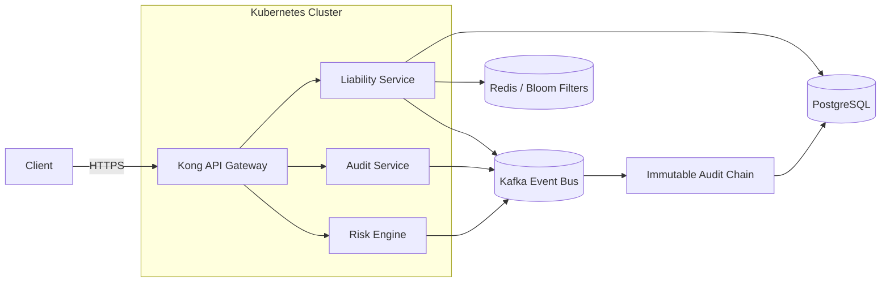
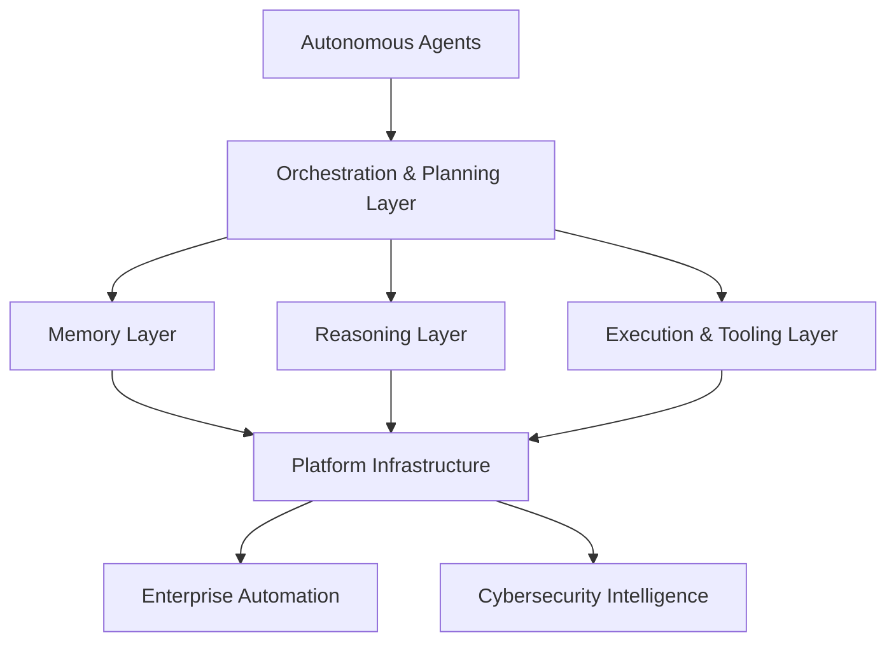

# Adeshina Emmanuel Abiodun

Backend, Platform & Security Engineer — Nigeria

[GitHub](https://github.com/emmanueladesina) · [Hashnode](https://hashnode.com/@emmanueladeshina01) · [Email](mailto:E.adeshina@proton.me)

---

I build backend and platform systems on the assumption that something will eventually fail — a node, a network partition, a dependency, an operator with too much access. My work is in distributed systems, event-driven architecture, and infrastructure security: the layer beneath the application that decides whether a failure is contained or catastrophic. I founded **RELIASTRA**, a financial liability intelligence platform built around immutable audit chains and Kubernetes-native infrastructure, and I'm building **CHIMERA**, an operating system for coordinating autonomous AI agents. Most of the work happens before a feature ships — modeling failure paths, defining service boundaries, and deciding what the system does when something goes wrong.

---

## Engineering Philosophy

I don't start with a framework or a language. I start with the failure modes: what happens when a downstream service is slow, when a message is delivered twice, when a deploy fails halfway through, when an operator has more access than the task requires. Service boundaries, consistency model, audit strategy, and deployment topology get decided using failure analysis and attack-path modeling as design inputs — not as a review that happens after the architecture is already fixed.

A few things follow from that:

- Distributed systems are designed as environments, not just code — the network is unreliable by default, and the architecture has to survive that.
- A state-change or audit path is designed to be immutable and race-condition-resistant before it's designed to be fast.
- Infrastructure policy — rate limits, isolation boundaries, access control — is derived from modeled attack paths, not applied as a checklist afterward.
- A system that can't be observed can't be trusted. Visibility into failure states is part of the design, not tooling added once something breaks.

> [!NOTE]
> Everything under **What I'm Building** below is production infrastructure that shipped — not a demo, a tutorial project, or a wrapper around someone else's API.

---

## What I'm Building

### RELIASTRA — Financial Liability Intelligence Platform

**Founder & Principal Backend Engineer**

RELIASTRA is a production-grade platform for financial liability intelligence, architected as an event-driven system with immutable auditing at its core. It evolved out of **TrustMonitor**, an earlier enterprise monitoring platform that grew to 826+ production API endpoints before becoming the foundation for RELIASTRA's backend.

**Architecture highlights**

- Event-driven microservice architecture, built from scratch
- Immutable audit chains, protected against race conditions and integrity failures
- Guardian-driven infrastructure policy — access and infrastructure rules derived from failure analysis and attack-path modeling before implementation
- Distributed locks, backpressure control, and Redis Bloom filters for load and duplication control
- Graceful connection draining and service isolation as first-class deployment concerns
- Kubernetes-native deployment: scalability, high availability, and disaster recovery designed in, not retrofitted

High-level request & event flow

**Stack:** Go · Python · Kubernetes · Docker · PostgreSQL · Kafka · Redis · Kong Gateway · Terraform · AWS

---

### CHIMERA — Intelligence Operating System

**Founder & Chief Systems Architect**

CHIMERA is a platform for coordinating autonomous AI agents — memory, planning, reasoning, and orchestration, built as backend infrastructure rather than application logic layered on top of a model.

> [!IMPORTANT]
> CHIMERA is infrastructure for coordinating agents, not an agent itself. It sits below the application layer — the same place RELIASTRA does.

**Architecture highlights**

- Modular orchestration architecture for coordinating multiple autonomous agents
- Backend infrastructure built to support autonomous execution, not just single-turn inference
- Extensible platform services designed ahead of the workloads that will run on them
- Infrastructure-first design: the platform is built before the applications on top of it

Conceptual layer model

---

## Areas of Interest

- **Platform Engineering** — the operational surface between application code and infrastructure: service boundaries, deployment topology, failure isolation.
- **Cloud Security** — access control and infrastructure policy modeled from attack paths, particularly around IAM.
- **Distributed Systems** — consistency, ordering, and failure handling across services and nodes.
- **AI Infrastructure** — the platform layer underneath autonomous agents: memory, orchestration, execution — not the model itself.
- **Production Reliability** — designing for degraded operation instead of designing for the happy path.
- **Backend Architecture** — service boundaries and data ownership as architectural decisions, not implementation detail.

---

## Technical Research

Technical writing at [hashnode.com/@emmanueladeshina01](https://hashnode.com/@emmanueladeshina01), covering AWS IAM, cloud security, distributed systems, production engineering, and backend architecture.

One piece models AWS IAM as a graph of relationships rather than a flat permission list — treating it as an attack-path analysis problem instead of purely an authentication concern.

---

## Selected Engineering Principles

- **Design for failure.** Every dependency is assumed to fail; the architecture defines what happens when it does.
- **Infrastructure before features.** Deployment topology, isolation boundaries, and failure recovery are designed before the feature that depends on them.
- **Security by architecture.** Access control and infrastructure policy come from modeled attack paths, not a checklist applied after launch.
- **Observable systems.** A failure state that can't be seen can't be diagnosed — visibility is part of the design.
- **Deterministic deployments.** A deployment behaves the same way in staging as it does in production, every time.
- **Operational simplicity.** Complexity is justified by the failure modes it prevents, not by the problem it makes easier to describe.

---

## Technologies

**Languages**

**Frameworks**

**Data & Messaging**

**Infrastructure & Orchestration**

**Gateway**

**Automation**

**Security**

---

## Current Focus

- Extending CHIMERA's orchestration layer to support persistent multi-agent memory and planning
- Hardening RELIASTRA's audit-chain and disaster-recovery paths for production scale
- Continuing the AWS IAM attack-path graph research

---

## Contact

- GitHub — [github.com/emmanueladesina](https://github.com/emmanueladesina)
- Hashnode — [hashnode.com/@emmanueladeshina01](https://hashnode.com/@emmanueladeshina01)
- Email — [E.adeshina@proton.me](mailto:E.adeshina@proton.me)
- Open Source — Kubernetes contributor, cloud-native infrastructure
